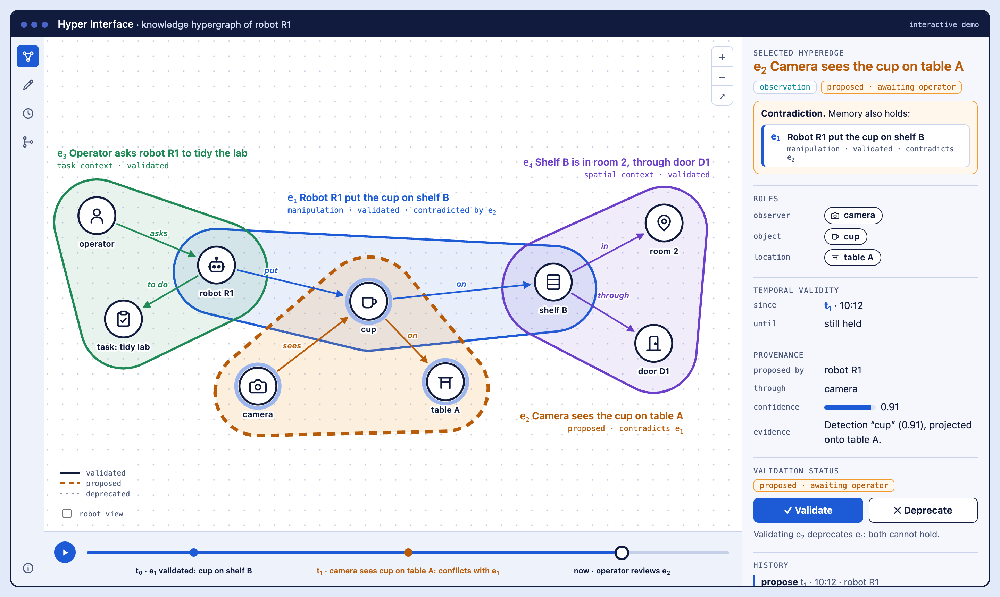

# Hyper Interface

**Human-Supervised Knowledge Hypergraph Memory for Autonomous Robots** — interactive demo of the ROBOT2026 poster.

João Viterbo Vieira · José Pedro Carvalho · A. Pedro Aguiar
Faculty of Engineering, University of Porto · SYSTEC-ARISE



A robot's persistent memory is a knowledge hypergraph. A hyperedge keeps a whole fact and its context as one
unit: who did what to which object, where, since when, and who said so. Hyper Interface lets an operator see
that memory, correct it, and trace how it changed.

## The example

The demo is the interface schematic from the poster, made interactive. Memory holds four facts:

| | fact | status |
|---|---|---|
| e1 | Robot R1 put the cup on shelf B | validated at t0 |
| e2 | Camera sees the cup on table A | proposed at t1, contradicts e1 |
| e3 | Operator asks robot R1 to tidy the lab | validated |
| e4 | Shelf B is in room 2, through door D1 | validated |

Each region is one fact, and its arrows read as its sentence. A solid outline is validated knowledge; a dashed
one is a proposal waiting for the operator. The cup cannot be in both places: validating e2 deprecates e1 in
the same step, and the timeline keeps both states readable.

This memory is an illustrative scenario, not a recording from a real robot.

## Run it

It is a static page with no build step and no network requests; its one library is vendored.

- Open `index.html` in a browser, or
- serve the folder (`python3 -m http.server`) and open <http://localhost:8000>.

## What you can do

The four icons on the left are the four capabilities in the paper.

| | capability | in the demo |
|---|---|---|
| A | Higher-order knowledge visualization | click a region or an entity to inspect it; drag entities; zoom and pan |
| B | Interactive knowledge management | create, edit and remove hyperedges and entities |
| C | Temporal knowledge exploration | the timeline replays memory states; the clock lists what changed at each one |
| D | Human–agent collaboration and provenance | review robot proposals; see who proposed each fact and through what; "robot view" shows only validated knowledge |

Edits are saved in the browser. "Reset demo" (under the clock) restores the example.

## Demonstration graphs

The `memory` selector (and the About panel) also opens three real knowledge hypergraphs. They are there for
demonstration only: read-only, and drawn only in **2D** and **3D**, where every hyperedge is a small coloured hub
linked to its members. The region drawing, editing, the timeline and review stay with the robot's memory.

| | what it is | size |
|---|---|---|
| Zotero KG | claims extracted from a research library, each checked against a verbatim quote (HyperKG-Zotero) | 271 papers · 4,191 hyperedges · 2,609 entities |
| Ontotipo | statements from 16 papers on knowledge hypergraphs, content layer (L2), same-as mentions merged (ontotipohypergraph, exp04) | 4,271 hyperedges · 7,430 nodes |
| HarnessKG · S2D | the task memory evolved for Symptom2Disease; frozen winner of seed 42, the best of seeds 42/43/44 on the test set (88.7 / 87.7 / 85.8 %) | 273 hyperedges · 395 nodes |

Click a node or a hub to read the claim, its roles, source and quote; search by name; "Show only its
neighbourhood" isolates one node. A link such as `index.html#set=zotero&view=2d` opens a graph directly.

Each graph is one `data/<id>.js` file with its 2D and 3D positions already computed, loaded only when opened.
To rebuild them from the source projects: `python3 tools/export_demo_graphs.py OUT`, then
`node tools/layout_demo_graphs.mjs OUT data` (from a folder where `d3-force-3d` is installed).

## Layout

```
index.html
css/style.css
js/data.js      the example memory and the data contract
js/store.js     append-only memory store: states, review actions, backends
js/canvas.js    the hypergraph drawing (rubber-band hulls, arrows, captions, pan and zoom)
js/view3d.js    the robot's memory in 3D
js/gallery.js   the demonstration graphs: loading, 2D/3D drawing, panel, search
js/app.js       side panel, timeline, forms
data/           zotero.js, ontotipo.js, s2d.js: the demonstration graphs
vendor/         3d-force-graph (the only dependency, vendored)
tools/          export_demo_graphs.py, layout_demo_graphs.mjs: how data/ was built
```

## Data model

Memory is a log; nothing is overwritten. The status of a fact at a given state is the result of replaying its
history up to that state.

```jsonc
{
  "entities":   [{ "id": "cup", "label": "cup", "kind": "object", "icon": "cup", "x": 978, "y": 546 }],
  "hyperedges": [{
    "id": "e2", "family": "observation", "sentence": "Camera sees the cup on table A", "contradicts": "e1",
    "members": [{ "node": "camera", "role": "observer" }, { "node": "cup", "role": "object" },
                { "node": "table-a", "role": "location" }],
    "flow":    [{ "from": "camera", "to": "cup", "word": "sees" }, { "from": "cup", "to": "table-a", "word": "on" }],
    "confidence": 0.91,
    "provenance": { "by": "robot R1", "via": "camera", "evidence": "…" },
    "history": [{ "c": 1, "op": "propose", "by": "robot R1", "note": "…" }]
  }],
  "commits":    [{ "id": 1, "t": "10:12", "label": "camera sees cup on table A: conflicts with e1", "by": "robot R1" }]
}
```

`history[].op` is one of `propose`, `assert`, `validate`, `deprecate`, `edit` (with a `patch`), `remove`.

## Connecting a real robot

The interface only talks to `HI.store`, whose backend is the browser by default. Opening the page with
`?api=https://host:port` switches to a REST backend that expects `GET {api}/memory` to return the document
above and accepts `PUT {api}/memory` after each operator change. This adapter is a starting point and has not
been run against a real service.
